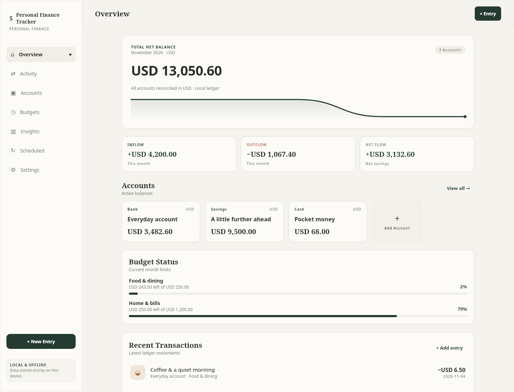
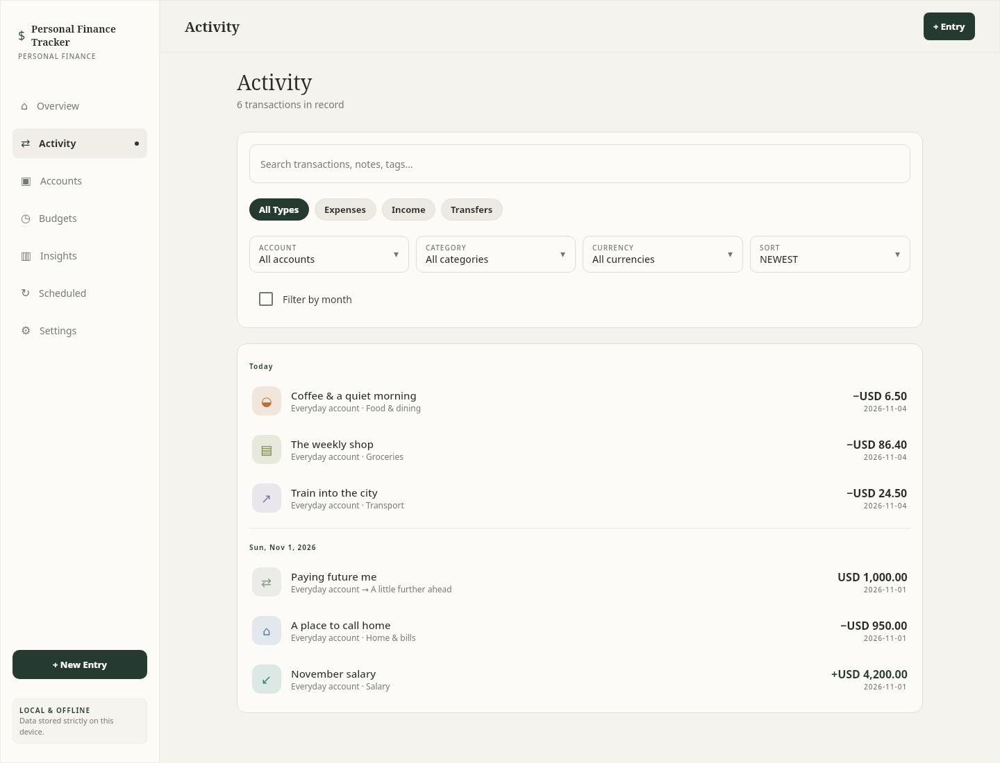
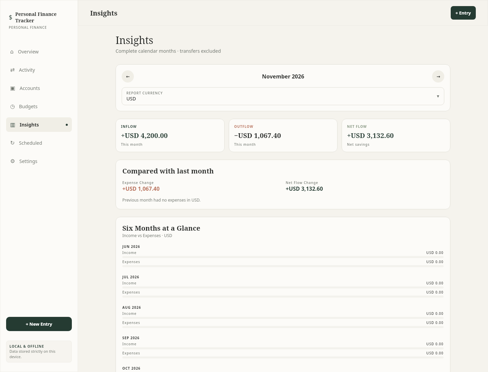
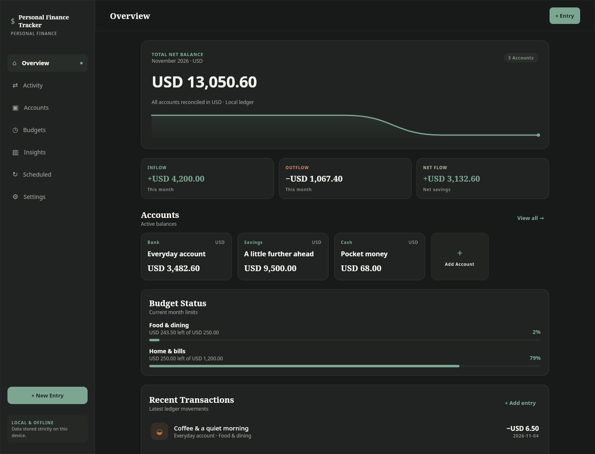
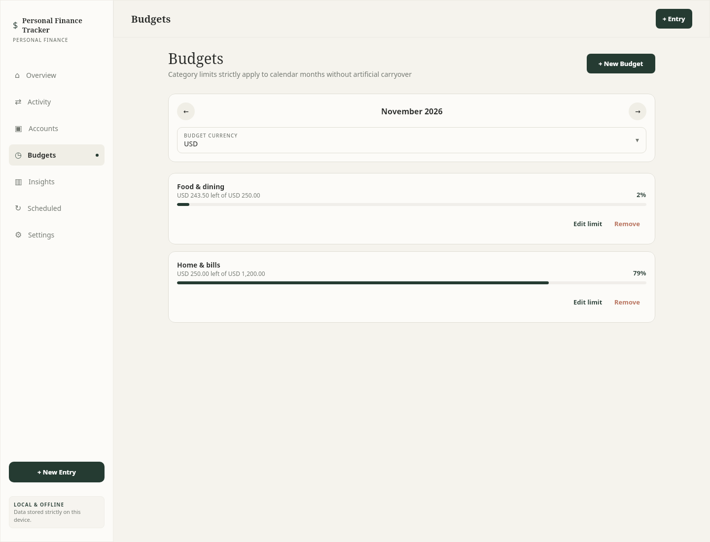
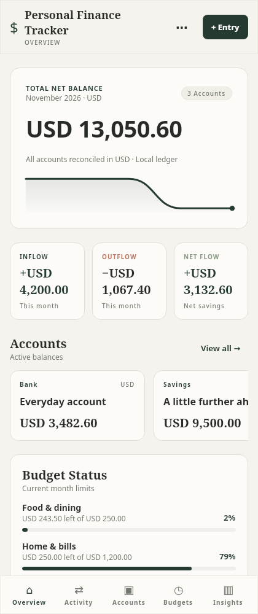
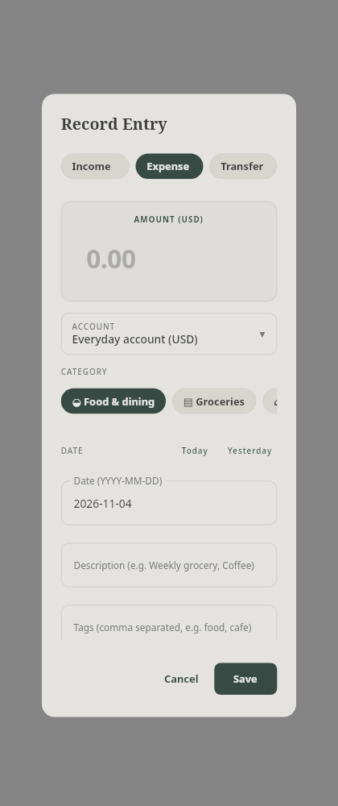
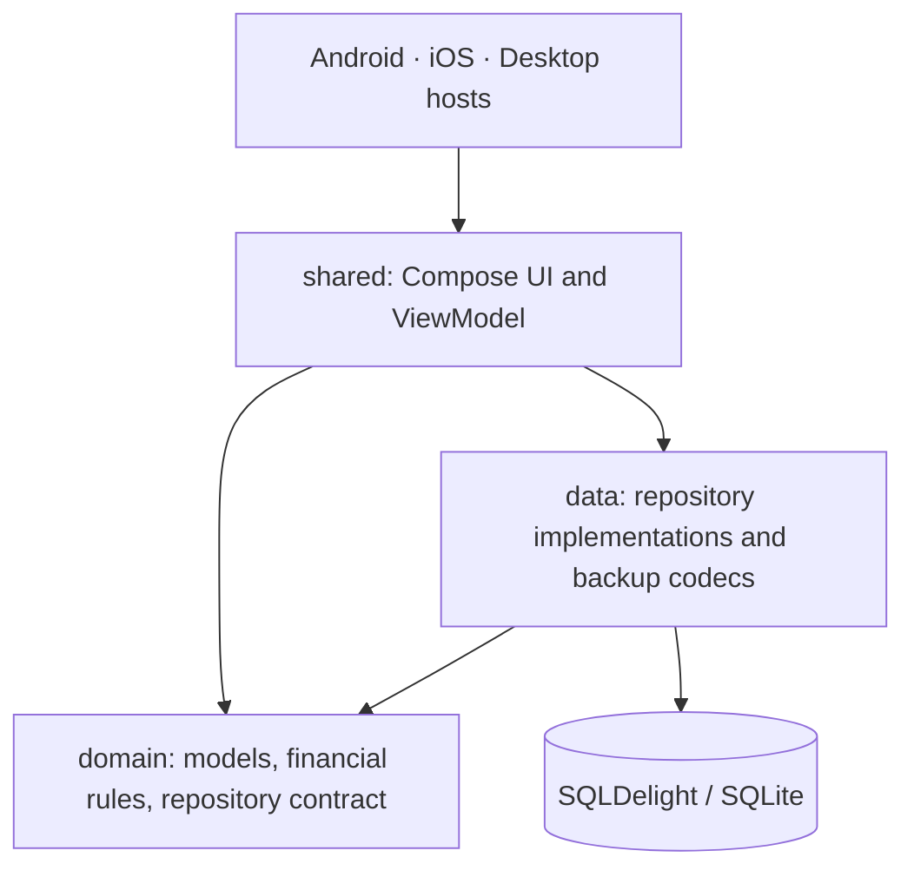

# Personal Finance Tracker

A personal finance app built with **Kotlin Multiplatform** and **Compose Multiplatform**, with shared UI, financial rules, and SQLite persistence for Android, iOS, and desktop.

This portfolio project demonstrates how I structure a multiplatform application, model money accurately, keep writes atomic, and build a responsive interface around reactive state.



## Features

- **Accounts and currencies:** cash, bank, savings, and custom accounts, with opening balances and currency-aware balance calculations.
- **Transactions:** income, expenses, and transfers, including cross-currency transfers that retain the amounts actually exchanged.
- **Activity:** search descriptions, notes, and tags; filter transactions and inspect individual entries.
- **Budgets:** monthly category limits, spending progress, and threshold indicators.
- **Insights:** income and expense comparisons, six-month trends, category spending, and net worth valuation using manually entered exchange rates.
- **Recurring entries:** daily, weekly, monthly, and yearly schedules with calendar anchors and duplicate prevention.
- **Data portability:** versioned JSON backup and restore, plus CSV export.
- **Appearance:** responsive desktop and mobile navigation, light and dark themes, and reporting currency and timezone preferences.

No server account or bank connection is required. The app manages manually entered financial records locally.

## Screenshots

| Activity | Insights |
| --- | --- |
|  |  |

| Dark theme | Budgets |
| --- | --- |
|  |  |

<details>
<summary>Mobile layout and transaction editor</summary>




</details>

The screenshots above use isolated sample data generated by [the screenshot renderer](tools/RenderScreenshots.kt). They illustrate the interface and may differ slightly from the latest source.

## Engineering highlights

### Money is modeled explicitly

Amounts use integer minor units with an explicit currency: USD 12.50 is stored as `1250`, while JPY 100 is stored as `100`. Arithmetic checks for overflow. Exchange rates use rational numerators and denominators, and conversions apply half-even rounding. Unsupported calculations report an error instead of silently substituting a balance.

See [Money.kt](domain/src/commonMain/kotlin/com/maksym/financetracker/domain/Money.kt) and the [JVM conversion oracle tests](domain/src/jvmTest/kotlin/com/maksym/financetracker/domain/ConversionOracleTest.kt).

### Persistence owns the commit boundary

SQLDelight provides typed SQLite queries and migrations. Repository writes validate a complete ledger snapshot and persist changes atomically before publishing state. Transfers are modeled as one record with source and destination amounts. Optimistic revisions reject stale edits, and occurrence identities prevent recurring entries from being generated twice.

See [SqlLedgerRepository.kt](data/src/commonMain/kotlin/com/maksym/financetracker/data/SqlLedgerRepository.kt) and the [database schema](docs/database-schema.md).

### Shared code, platform-specific adapters

A lifecycle-owned ViewModel exposes state through Kotlin Flow. Compose renders the shared screens, while platform adapters handle database drivers and file selection. Constructor injection keeps dependencies explicit and lets tests substitute repositories and clocks.



| Module | Responsibility |
| --- | --- |
| `domain` | Money, models, validation, analytics, recurrence, and repository contracts |
| `data` | SQLDelight schemas and drivers, atomic writes, JSON backup, and CSV export |
| `shared` | Compose screens, design system, navigation, editors, and presentation state |
| `androidApp` | Android entry point and launcher resources |
| `desktopApp` | JVM window, desktop icon, and packaging configuration |
| `iosApp` | SwiftUI host and Xcode project |

## Stack

| Technology | Configured version |
| --- | --- |
| Kotlin | 2.4.21 |
| Compose Multiplatform | 1.12.2 |
| Material 3 | 1.12.0-alpha03 |
| SQLDelight | 2.2.1 |
| Coroutines | 1.11.0 |
| kotlinx-datetime | 0.7.1 |
| kotlinx-serialization JSON | 1.8.1 |
| Gradle / Android Gradle Plugin | 9.6.0 / 9.3.1 |

Dependency versions are centralized in [gradle/libs.versions.toml](gradle/libs.versions.toml).

## Run locally

Use **JDK 21**. Android builds also require the Android SDK with platform **37**; the minimum supported Android API is **24**. iOS builds require macOS and a compatible Xcode installation. Open the project in an IDE with Kotlin Multiplatform support, or use the included Gradle wrapper.

### Desktop

```bash
./gradlew :desktopApp:run
```

### Android

Configure your Android SDK through Android Studio or an untracked `local.properties` file, then build:

```bash
./gradlew :androidApp:assembleDebug
```

The APK is written to `androidApp/build/outputs/apk/debug/`. To run on an emulator or device, select the `androidApp` configuration in Android Studio.

### iOS

Open `iosApp/iosApp.xcodeproj` in Xcode, select the `iosApp` scheme, and run on a simulator or configured device. Device builds require your own signing team.

## Tests

Run the JVM domain, persistence, and presentation suites:

```bash
./gradlew :domain:jvmTest :data:jvmTest :shared:jvmTest
```

The tests cover monetary precision and overflow, rational conversion against a JVM oracle, balances and transfers, recurrence anchors, backup validation, SQLite repository behavior, and ViewModel state transitions.

See the [verification notes](docs/verification.md) for the recorded checks and platform limitations.

## Scope and trade-offs

This is a portfolio application with an implemented local finance workflow. Bank synchronization, cloud accounts, application-level encryption, and background execution while the app is closed are outside the current scope. Exchange rates are entered manually. Transaction filtering and reports operate on an in-memory ledger snapshot, so large-ledger query paging remains a future improvement. JSON backups are plaintext and should be stored accordingly.

## Further reading

- [Architecture proposal](docs/architecture.md)
- [Implementation decisions and trade-offs](docs/decisions.md)
- [Database schema](docs/database-schema.md)
- [Implementation roadmap](docs/implementation-roadmap.md)
- [Contributing](CONTRIBUTING.md)

## Author and license

Created by [Maksym Sytnyk](https://github.com/MaksymSytnyk) as a Kotlin Multiplatform portfolio project.

Licensed under the [MIT License](LICENSE).
