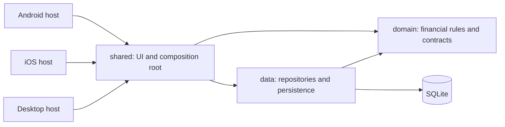

# Architecture proposal

Phase 1 • 2026-11-04 • Proposed design, not an implementation claim.

Build an offline personal finance product with shared Kotlin business logic and Compose UI on Android, iOS, and Desktop. Correctness of recorded money, understandable reporting, and reliable recovery take priority over feature count. The first release covers manually managed cash, bank, savings, and custom accounts. Bank connections, investment cost-basis accounting, credit amortization, and remote synchronization are outside this release.

The existing project has `shared`, `androidApp`, `desktopApp`, and an Xcode host. It contains the generated greeting screen and example tests. No financial domain or persistence exists. No applicable AGENTS.md or Git repository metadata was found. Preserve the platform hosts and evolve the starter rather than regenerate it.

## Technology decisions

Versions below are proposed exact pins. Documentation establishes a compatibility baseline; dependency resolution, compiler checks, native linking, and runtime tests must still pass in Phase 2. No source or build configuration was changed in Phase 1.

| Component | Proposed choice | Reason / verification |
| --- | --- | --- |
| Kotlin / Compose compiler / serialization plugin | 2.4.21 | Keep the existing Kotlin pin; compiler plugins share its version. |
| Compose Multiplatform | 1.12.2 | Existing stable framework; share UI across all three targets. |
| Android Gradle Plugin | 9.3.1 | Replace 9.5.0: Kotlin's documented support ends at 9.3.1. Keep Google's Android KMP library plugin. |
| Gradle / JDK | 9.6.0 / 21 | Existing wrapper with checksum; within the documented Kotlin range and above AGP 9.3's Gradle/JDK minimums. Align source/bytecode targets explicitly in Phase 2. |
| Android | min SDK 24, compile/target SDK 37 | Preserve existing SDK choices; AGP 9.3 documents API 37 support. |
| iOS | deployment target 16; arm64 device + arm64 simulator | Product baseline; macOS with compatible Xcode is a release requirement. Kotlin's table lists Xcode 26.4. |
| Desktop | JVM, host-native distribution packaging | Retain Desktop; useful for development and meaningful database tests. Package on each destination OS. |
| Material 3 | 1.9.0 stable candidate | Replace the existing 1.12.0-alpha03. The stable artifact is documented by JetBrains; mixing it with Compose 1.12.2 requires the Phase 2 UI/native smoke test. |
| Lifecycle / ViewModel | 2.11.0 | Listed in Compose 1.12.2's component matrix; use lifecycle-owned scopes. |
| Navigation 3 | 1.1.2 stable candidate | Listed in Compose 1.12.1's matrix; serialized typed destinations, explicit back stacks. Validate against 1.12.2 before accepting the pin. |
| Coroutines / coroutines-test | 1.11.0 | Flow, StateFlow, structured concurrency, deterministic coroutine tests. Upstream release uses Kotlin 2.2.20. |
| kotlinx-datetime | 0.8.0 | Calendar dates, named time zones, recurrence arithmetic; use kotlin.time.Clock/Instant for timestamps. |
| kotlinx-serialization-json | 1.12.0 | Versioned backup DTOs and route state; upstream release is based on Kotlin 2.4.10. |
| SQLDelight | 2.2.1 | Compile-checked SQL, explicit transactions/migrations, reactive queries; Android, native SQLite, and JVM SQLite drivers. Gradle 9/new Android plugin integration is an early build spike. |
| Dependency injection | Constructor injection + explicit AppGraph | Small, inspectable object graph; no reflection, global service locator, or extra runtime dependency. Platform hosts own resource lifetimes. |
| Network | ExchangeRateProvider interface; persisted manual rates | Offline behavior works without credentials. Add Ktor only with a concrete remote provider and its contract tests; no unused client dependency. |
| Tests | kotlin.test, coroutines-test, real SQLite drivers, Compose UI tests | Fakes for state tests; actual SQLite for persistence and transaction tests. Add tools only when a test requires them. |

Primary sources checked on 2026-11-04:

- [Kotlin toolchain compatibility](https://kotlinlang.org/docs/multiplatform/multiplatform-compatibility-guide.html) and [Compose compatibility](https://kotlinlang.org/docs/multiplatform/compose-compatibility-and-versioning.html).
- [AGP 9.3 requirements](https://developer.android.com/build/releases/agp-9-3-0-release-notes).
- [Compose 1.12.2 components](https://github.com/JetBrains/compose-multiplatform/releases/tag/v1.12.2), [1.12.1 components](https://github.com/JetBrains/compose-multiplatform/releases/tag/v1.12.1), and [stable Material 3 artifact](https://github.com/JetBrains/compose-multiplatform/releases/tag/v1.9.3).
- [Multiplatform Navigation 3](https://kotlinlang.org/docs/multiplatform/compose-navigation-3.html).
- [SQLDelight multiplatform drivers](https://sqldelight.github.io/sqldelight/2.2.1/multiplatform_sqlite/) and [release notes](https://github.com/sqldelight/sqldelight/releases/tag/2.2.1).
- [Coroutines releases](https://github.com/Kotlin/kotlinx.coroutines/releases), [serialization 1.12.0](https://github.com/Kotlin/kotlinx.serialization/releases/tag/v1.12.0), and [datetime 0.8.0](https://github.com/Kotlin/kotlinx-datetime/releases/tag/v0.8.0).

If a candidate combination fails, choose a documented compatible set and record the reason before feature implementation. Do not suppress compatibility warnings to declare success.

## Module boundaries

```text
:domain                 KMP; core money/time/IDs, models, repository contracts, use cases
:data                   KMP; SQLDelight, mappings, repositories, backup DTOs, rate storage
:shared                 KMP; Compose screens, presentation state, design system, AppGraph
:androidApp             Android entry, database location, file picker/share integration
:desktopApp             JVM entry, database location, file dialogs, packaging
iosApp/                 Swift host, native file/share bridge, Xcode configuration
docs/                   Decisions, schema, roadmap, verification evidence
```



The `shared` composition root constructs data implementations; screen/ViewModel packages depend only on domain interfaces. `domain` has no Compose, SQLDelight, platform UI, or serialization dependency. Use `core/money`, `core/time`, and `core/result` packages inside domain instead of creating numerous tiny Gradle modules. Organize presentation by feature. Use cases represent operations with policy or transaction boundaries, not one wrapper per repository method.

Platform adapters cover database drivers/paths, locale-aware input and display, file import/export, and optional background scheduling. No platform singleton leaks into business rules. Inject Clock, reporting zone, dispatchers, and ID generation. Maintain one application-owned database/writer per process; close it with its owner. Desktop uses a single instance for each data directory.

## Domain vocabulary

| Entity / value | Contract |
| --- | --- |
| CurrencySpec | ISO code plus immutable minor-unit precision from a versioned, reviewed supported-currency catalog; unknown codes rejected. |
| Money | Signed Long minor units + CurrencySpec; checked arithmetic and same-currency operations. |
| Account | UUID, name, type, currency, opening balance/date, created/updated timestamps, archived state, revision. Current balance is a derived projection. |
| Transaction | Sealed Income, Expense, Transfer; UUID, positive amount, account, business date, description, optional notes/tags, created/updated timestamps, revision. Income/expense require a matching category. |
| Transfer | One transaction with source account/amount and destination account/amount; immutable executed FX details when currencies differ. |
| Category / Tag | Stable IDs; categories have income/expense kind, name, icon key, color token, predefined flag, archive state. Tags have names. |
| MonthlyBudget | Category, currency, calendar month, positive limit; spending/remaining/utilization are projections. |
| RecurringRule | Validated transaction template, calendar unit, positive interval, original anchor, named zone, next due date, optional end date, status, revision. |
| Occurrence | Unique rule/date identity, template revision, outcome, optional generated transaction ID. Survives deletion of a generated transaction. |
| ExchangeRate | Directed currency pair, positive exact rational rate, source, observed timestamp, recorded timestamp. |
| AnalyticsSnapshot | Period, currency, income, expense, cash flow, category/trend series, budget usage, comparison, coverage metadata. |

Meaningful operations: SaveTransaction, DeleteTransaction, TransferBetweenAccounts, SaveAccount, SetMonthlyBudget, GenerateDueTransactions, GetFinancialOverview, ExportTransactions, ValidateBackup, RestoreBackup. Repository writes expose expected revisions and typed failures. Persistence models never escape data.

## Financial policies

**Amounts.** Parse decimal text directly into minor units. Never parse through Float/Double. Reject excess fractional digits instead of rounding user-entered money. Arithmetic checks addition, subtraction, multiplication, negation, and aggregate overflow. Amounts use positive magnitudes; transaction kind determines direction. Zero/negative transaction amounts are validation errors; signed and zero account balances are valid. Long.MIN_VALUE needs explicit handling and must never be passed through unchecked absolute-value/negation. Reject unsupported magnitudes with a field error. Cash denomination rounding is outside scope; currency precision is not a cash-rounding rule.

**Conversion.** A rate is quote major units per base major unit, stored as positive integer numerator/denominator. Compute destination minor units as sourceMinor × numerator × 10^destinationScale / (denominator × 10^sourceScale). Reduce factors and use checked integer quotient/remainder arithmetic; reject an unsupported intermediate range explicitly. Round once at the final minor unit using half-even, return the rounding remainder, and display the preview before saving. Test this implementation against an independent JVM BigInteger/BigDecimal oracle. No floating-point intermediate, inverse-rate truncation, or silently substituted rate.

**Transfers.** One row represents both legs. Source/destination must differ; currencies match their accounts. Same-currency amounts are identical. Cross-currency transfers persist both actual amounts and the executed ratio with source/time; an indicative quote must not override bank-confirmed received money. Fees are explicit linked expense transactions saved with the transfer. Transfers and opening balances are excluded from income, expense, and budget totals. Editing/deleting a transfer changes both legs atomically; associated fees require an explicit include/retain choice.

**Balances.** Opening balance + income − expense − sent transfers + received transfers. Calculate from authoritative rows in a consistent database snapshot, using checked sums, rather than persisting a second mutable current balance. Do not use SQLite TOTAL or floating-point casts for money. Reject a write if affected account totals cannot be represented. Account currency becomes immutable after use; archived accounts retain history and are included in net worth until explicitly excluded by the user. Negative balances are permitted and displayed. Changes to opening balances are explicit corrections, never income. Transaction dates cannot precede the relevant account opening dates.

**Currency reporting.** Income, expenses, trends, amount sorting, and monthly budgets operate in one selected currency. Show other-currency activity and its exclusion clearly. Never sort monetary magnitudes across unlike currencies as though comparable. Net worth optionally converts balances using persisted local/manual rates into a selected reporting currency, with as-of/source/staleness and coverage shown. Missing rates produce an incomplete valuation, not a misleading total. Manual rates are labeled manual; test fixture rates never appear as market data. Quote selection is deterministic (latest observed time at/before valuation time, then recorded time and ID). Future remote providers use the same contract. Market revaluation is not income. Investment-style realized FX gains/losses are outside this cash-account model and will not be invented from two transfer legs.

**Budgets and analytics.** A budget is unique per category/month/currency and includes only matching expenses in [month start, next month start). Remaining = limit − spending and may be negative. Warn at 80% and 100%; never clamp the textual overrun. Clamp only the visual track and label any overrun. Full periods compare to full previous periods; month-to-date compares equal elapsed days capped to the previous month's length. A zero previous denominator displays an absolute change with percentage unavailable. Empty chart data remains empty. Charts use zero baselines for bars, visible units, and accessible values. Any float coordinates exist only after exact financial results are finalized for rendering.

**Dates.** Store an explicit LocalDate for the user's accounting date and UTC Instants for audit timestamps. Travel/timezone changes do not move booked transactions into other months. A persisted reporting zone determines 'today'; changing it is explicit. Future-dated entries are scheduled rather than posted. Recurrence uses its own named zone and calendar dates, not durations of 24 hours. Clock skew must not make updatedAt precede createdAt; revision numbers control concurrency.

**Recurrence.** Daily/weekly/monthly/yearly rules support an interval N. Monthly schedules preserve the original day: Jan 31 → Feb 28/29 → Mar 31. Feb 29 yearly rules use Feb 28 in non-leap years and return to Feb 29 in leap years. Generate overdue dates in bounded, resumable batches. Within one database transaction, recheck the rule revision, insert the unique occurrence, write the financial transaction, and advance the cursor. Roll back all on failure. Duplicate callers rely on the database unique key, not only a coroutine mutex. Deleted/skipped occurrences remain recorded and are never recreated automatically. Editing a schedule affects only future unprocessed occurrences. Archived accounts/categories or unavailable required FX put a rule into an actionable error state. Cross-currency recurring transfers require a received amount or an explicitly accepted rate policy; never reuse an incidental market quote silently.

**Execution guarantee.** Foreground startup/resume always runs catch-up off the main thread. Android/iOS background adapters are opportunistic. The product promises recovery of due occurrences on the next run, not execution at an exact time while the OS suspends the app. Users see catch-up progress and per-rule failures.

## Persistence, concurrency, and failures

[Schema](database-schema.md) defines the database boundary. SQLDelight queries expose Flow; repositories map rows into immutable domain projections. A write transaction includes validation against current rows, expected-revision checks, relationship changes, and affected-balance validation. Do not suspend for network/file operations inside a database transaction. Retry busy writes in a bounded manner; never retry a non-idempotent operation blindly. A stable operation/transaction ID prevents double-submit duplication.

Use coherent read transactions for multi-query dashboard snapshots rather than combining independently refreshed totals into a transiently inconsistent screen. Transactions are serialized by the database, and optimistic revisions reject stale forms. Cancellation propagates; do not convert CancellationException into a generic error. Expected errors include InvalidAmount, CurrencyMismatch, MissingRate, ArchivedReference, Conflict, Overflow, StorageUnavailable, InvalidBackup, and UnsupportedBackupVersion. ViewModels expose actionable field or screen errors without raw SQL/financial data in logs.

Backup is a versioned logical JSON snapshot, not a copy of an open SQLite file. Encode monetary integers as decimal strings to preserve them in other tooling. Include settings, currency metadata, rates, rules, occurrence tombstones, tags, and IDs. Export from a coherent read snapshot. Restore first checks size/schema/version, all IDs/references, invariants, and balances in staging; show counts and replacement scope; replace atomically only after user confirmation. Failed/cancelled imports preserve existing data. Initial release supports replace, not ambiguous merge. Plaintext exports are clearly labeled sensitive at the save action. App data stays in platform-private storage; no claim of application-level encryption.

CSV exports one row per logical transaction, with separate transfer source/destination amount and currency columns, ISO dates, invariant decimal text, quoted fields, and formula-injection protection for user text. CSV is a reporting export; JSON is the lossless restore format. Native file dialogs/share sheets are platform capabilities with explicit cancellation states.

Repository boundaries allow a future sync implementation, but this release does not prebuild a backend or claim sync compatibility without conflict resolution. Stable IDs, revisions, and preserved recurrence identities provide a useful starting point.

## Navigation and visual direction

Primary destinations: Overview, Transactions, Accounts, Budgets, Insights. Settings is available from the app header/sidebar. Recurring rules and Categories are accessible from Transactions and Settings respectively. A persistent Add action opens Income / Expense / Transfer with appropriate fields. Routes carry IDs and filter parameters, never mutable domain objects.

```text
First launch → currency/zone setup → first account → Overview
Overview → account details / transaction details / budget details
Transactions → search + filters → details → edit/delete
Accounts → account details → history / edit / transfer / archive
Budgets → month selection → category budget → matching transactions
Insights → period + currency selection → category drilldown
Settings → categories / recurring rules / rates / export / backup / theme
```

Use bottom navigation on compact screens and a navigation rail/sidebar with list-detail panes on wider screens. Maintain each top-level destination's navigation/filter state; support Android back, iOS back gestures, desktop Escape, keyboard focus, and saved route restoration. Unsaved transaction drafts need an explicit discard decision. No invisible/dead actions or empty screens masquerading as completed features.

Visual identity: warm neutral surfaces, deep teal primary actions, restrained amber warnings, clear semantic error colors, tabular amount numerals, 4/8-point spacing, and modest rounded containers. Dark theme uses graphite surfaces and adjusted contrast. Overview prioritizes balances/valuation coverage, current-period cash flow, budget pressure, recent activity, and upcoming recurring entries. No decorative investment charts for cash accounts.

Every screen has defined initial loading, empty, content, refresh, recoverable error, and mutation progress states. Save is disabled during submission; success appears only after commit. Error recovery preserves input. Support large fonts, screen readers, minimum touch targets, non-color status cues, reduced motion, and accessible chart summaries. Use small Compose chart components with exact-domain inputs instead of adopting a chart dependency before a need exists.

## Risks and acceptance gates

| Risk | Mitigation / required evidence |
| --- | --- |
| Toolchain/plugin integration | Resolve and compile SQLDelight + serialization + UI on all targets before domain feature work. |
| Restricted local build environment | Use a writable Gradle cache where possible; record infrastructure failures separately from compilation failures. Run required jobs in a suitable environment. |
| Native behavior differs from JVM | macOS simulator tests, native DB rollback/migration tests, file picker and keyboard smoke tests; Linux does not validate iOS. |
| Arithmetic overflow / FX rounding | Boundary and property-style tests plus independent arithmetic oracle; explicit range failures. |
| Duplicate recurrence / destructive restore | Unique occurrence IDs, transactional cursor updates, fault-injection and concurrent-writer tests, staged atomic restore. |
| Unavailable/stale FX | Manual provider, source/time display, explicit incomplete net worth; no fabricated conversion. |
| Large history / slow queries | Indexed predicates, keyset pagination, query plans and seeded 100k-row benchmark; optimize only from measurements. |
| Preview dependency instability | Stable Material/navigation candidates first; document any necessary pre-release dependency and limit its exposure. |
| Polished UI scope overwhelms core work | Deliver usable slices; financial rules and persistence tests gate each screen integration. |

Phase execution, tests, current build evidence, and next steps are in [the roadmap](implementation-roadmap.md).
