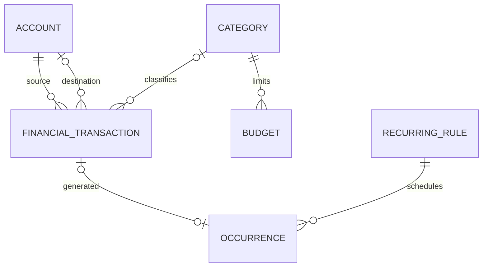

# Database schema

The source of truth is [`Finance.sq`](../data/src/commonMain/sqldelight/com/maksym/financetracker/db/Finance.sq). SQLDelight generates the typed query interface. SQLite INTEGER stores minor units and UTC epoch milliseconds; business dates are ISO calendar dates in TEXT.

| Table | Purpose and important constraints |
| --- | --- |
| `meta` | One row: global optimistic revision, reporting currency, zone, theme. |
| `account` | Name, currency/type, signed opening amount/date, archive state, audit timestamps. |
| `category` | Income/expense kind, name, icon, color, archive state. |
| `financial_transaction` | Positive source amount/currency, type, account FK, category FK or destination account FK/received amount, business date, description/notes/tags, timestamps, FX provenance. A transfer's two legs occupy one row. |
| `budget` | Expense category FK, month, currency, positive limit; unique per category/month/currency. |
| `recurring_rule` | Transaction template JSON, frequency/interval, anchor, ordinal cursor, zone, optional end, active state. |
| `occurrence` | Primary key `(rule_id, date)`; optional unique transaction FK. A deleted occurrence keeps its primary key with a null transaction reference. |
| `rate` | Directed currency pair, positive integer numerator/denominator, observed time, source; unique pair/observation time. |

Foreign keys are enabled in every driver configuration. Transfers require distinct accounts, both destination fields, and no category. Income/expense require a category and no destination. Amounts and budget limits must be positive. Used identities are archived; financial history is not deleted through a parent cascade. Transaction date/account/destination/category indices support future database paging.

The domain additionally checks currency matching, category kind, calendar validity, supported precision, amount range, archive policy, opening dates, recurring template validity, and every account balance. These rules run before persistence inside the repository's serialized operation. SQL transactions additionally recheck the persisted revision to reject a competing writer.

Current balance is derived as opening + income − expense − sent transfers + received transfers. Transfers and opening amounts do not contribute to income, spending, or budgets. There is no mutable balance cache and no floating-point SQL aggregate.

Normal commits diff records. Deleting a generated transaction clears its occurrence reference before deleting the transaction. Whole-backup restore explicitly replaces the graph in dependency order inside one SQL transaction. StateFlow publishes only after commit. Multi-table reads use one read transaction.

## Migration evidence

The checked-in `databases/1.db` is a schema fixture without transaction notes. `migrations/1.sqm` adds the notes column, bringing it to schema version 2. The fixture demonstrates and tests forward migration; it does not imply a previously published v1 release. SQLDelight migration verification is enabled, and `tools/check-sql.py` independently tests the migration, preserved 64-bit values, query syntax, FK rejection, duplicate occurrence prevention, and rollback.

Backup format version 1 is independent of SQL schema version. Tags and templates are explicit value-object JSON; core financial relationships remain relational. Backup imports validate the entire graph before touching live data. Unknown future formats and mismatched currency precision are rejected.
